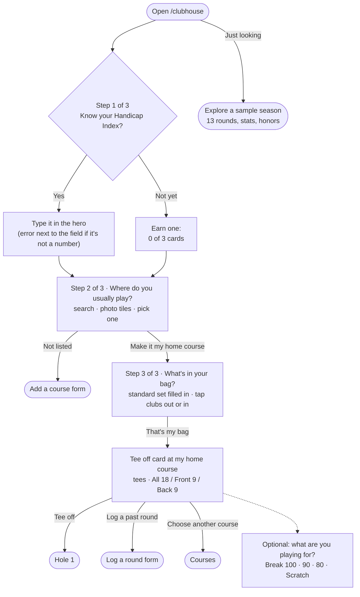
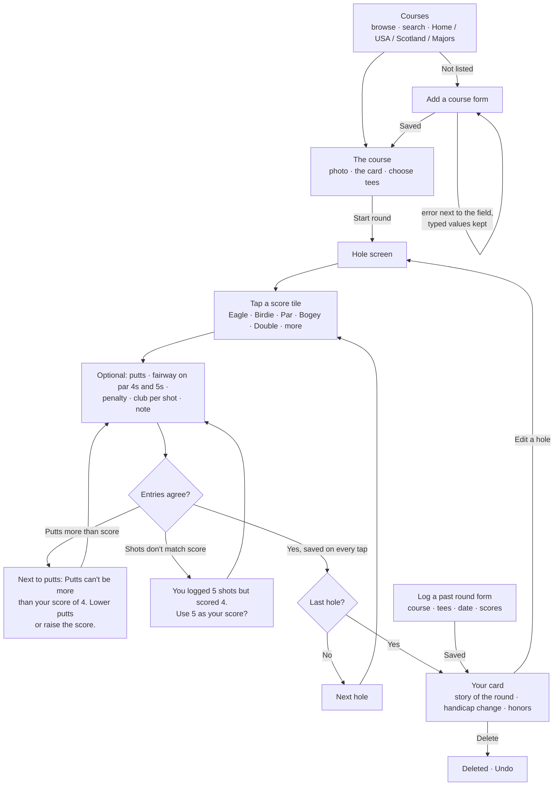
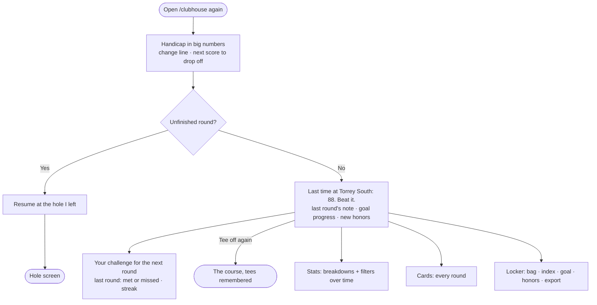

# 18 Eagles

A personal golf round journal. Play a round hole by hole, keep every card, and watch your handicap move.
Built for Design, Build, Ship (MPCS 51238, Autumn 2026), Assignment 3: Patterns & Flows.

- **The tool:** https://18-eagles.vercel.app/clubhouse
- **Progress hub** (research, mood board, design system, flows): https://18-eagles.vercel.app

Everything is saved in your browser (localStorage). There are no accounts, no database, and no external APIs.

## User flows

A personal golf round journal. Everything is saved on this device (localStorage).

**The main task, as one sentence:**
> I pick my course → I tee off → I tap my score on each hole (and the clubs, if I want) → I finish → my card is saved and my handicap moves.

## The three flows

1. **First visit:** I open 18 Eagles → three quick questions on the Clubhouse itself, each saved as I answer: my
   Handicap Index (or "Not yet: I'll earn one"), **where I usually play** (pick my home course from photo tiles, or add it),
   and **what's in my bag** (a standard set is filled in; I tap clubs out or in) → the Tee off card opens at *my* course
   with its tees → I tap **Tee off** → I'm on hole 1. (Just looking? "Explore a sample season" fills it with 13 rounds.)
2. **Main task:** I choose a course → I pick my tees → I score each hole (score tiles, putts, fairway, penalties,
   clubs, a note) → after the last hole I see my card, the story of the round, and what changed.
3. **Coming back:** I open 18 Eagles → I see my handicap and how it moved, and any unfinished round to resume → "Last time at
   Torrey South: 88. Beat it." → I tee off at the course I play most, with last round's note in view.

### 1 · First visit (nothing saved)


### 2 · Main task: play a round


### 3 · Coming back


## Routes (a page for each step, one shared nav)
| Route | Step | Nav label |
|---|---|---|
| `/clubhouse` | First visit / coming back home: the handicap, tee off, resume | Clubhouse |
| `/clubhouse/courses` | Choose a course | Courses |
| `/clubhouse/courses/[slug]` | The course, its card, tee choice, start | — |
| `/clubhouse/courses/new` | Form: add a course | — |
| `/clubhouse/rounds/[id]/[hole]` | Playing: the hole screen | — (its own focused header) |
| `/clubhouse/rounds/[id]` | The finished card, the story, what changed | — |
| `/clubhouse/rounds` | Every card (history) | Cards |
| `/clubhouse/rounds/new` | Form: log a round I've played | — |
| `/clubhouse/stats` | Breakdowns with filters | Stats |
| `/clubhouse/locker` | The bag, index and goal, honors, export/reset | Locker |
| `/clubhouse/trophies` | The Trophy Room: this week's case, crystal, career | — (from the Clubhouse and Locker) |

## States and errors we design for
- **Empty:** no rounds → the hero asks three setup questions (index, home course, bag), then the tee off card opens at that course. No blank stats: they show "after 1 round" previews with the goal.
- **One round:** the stats are honest ("1 round") and the handicap tracker reads 1 of 3.
- **In progress:** autosaved on every tap; resume from the clubhouse; the hole screen remembers the last hole.
- **9 holes:** front or back nine; 9-hole scores pair up toward the index.
- **Validation:** putts ≤ score; shot count vs score reconciled; fairway hidden on par 3s; scores 1–15; dates not in the future;
  index −10.0 to 54.0; slope 55–155; rating within reach of par. Every error sits next to its field and says what to do.
- **Destructive:** delete a round → Undo. Erase everything (Locker) → the one confirmation dialog.

## First visit (the onboarding)
Open the tool with nothing saved and it never shows an empty screen or a tour. The Clubhouse itself asks three short
questions, one at a time, and each answer is saved the moment it's given:
1. **Your Handicap Index:** type it (errors sit next to the field), or "Not yet: I'll earn one" (three cards).
2. **Where do you usually play?** Photo tiles of 28 courses (home courses, the PGA majors, Scotland) with search, or
   "My course isn't here" → the Add a course form.
3. **What's in your bag?** A standard 14 is filled in; tap clubs out or in. These become your buttons on every hole.

Then the Tee off card opens at *your* course with its tees, and one tap puts you on hole 1: learning by doing.
Under the question, a showcase for newcomers only: the trophies waiting to be won, a still of the one-tap hole screen,
the handicap worked out for you, the next-round challenge, and course photos from Augusta to St Andrews.
Someone just looking can tap **Explore a sample season** and see the whole app full (13 rounds, stats, honors).
How GHIN, 18Birdies and Arccos onboard, and what we took from each: [`docs/research/`](docs/research/).

## A reason to come back
- **The Trophy Room, every week.** A trophy case at the top of the Clubhouse resets each Monday: the Low Round of
  the Week (your best card this week ranked against all of yours: #1 gold, top 3 silver, top quarter bronze), the Jacket
  (beat your goal this week) and the Challenge Medal. Crystal for eagles, aces and birdie runs, and 22 career trophies
  (Broke 90, Amen Corner, Course Record, Ten Cards…). Thirty in all, worked out from your cards, never stored.
- **Your handicap, moving.** The index in big numbers, how it changed since the last card, your low, and which old
  score your next card will push out of the best 8 of 20.
- **Your challenge for the next round.** After each card, 18 Eagles picks your weakest area from your recent rounds
  (three-putts, doubles, penalties, fairways…) and sets one concrete target. When you come back it says whether you
  met it, and keeps your streak.
- **Beat your last card.** "Last time at Torrey South: 88. Beat it.", with the note you left yourself.
- **Resume.** A round in progress is saved on every tap and waits at the hole you left.
- **New since your last visit.** Trophies won since you were last here are marked New on the shelf.

Everything is saved in localStorage: rounds, the bag, the profile, honors seen, and the time of your last visit.

## Accessibility
- **Keyboard:** every flow was done keyboard-only (skip link, tab order, arrow keys in radio groups, Escape in the
  dialog, focus moved to the new heading after each step and page change). Report: [`docs/verification-keyboard.md`](docs/verification-keyboard.md).
- **Real labels:** every field has a visible `<label>` (search fields have a screen-reader label), hints and errors are
  tied to it with `aria-describedby`, errors are announced and focus moves to the first one, and typed values are kept.
- **Contrast, checked by the agent:** every text/background pair the components use is measured from the design tokens
  (`node --no-warnings src/app/design-system/measure-contrast.mjs`): all pass WCAG AA, and the script fails if the CSS
  drifts. The table is on [/design-system](https://18-eagles.vercel.app/design-system).
- **Automated + sizes:** axe-core on every page in empty, one-round, full-season and mid-round states, at 11 screen
  widths from 320px, with 200% zoom. Report: [`docs/verification.md`](docs/verification.md).
- Scores are never color alone (signs and shapes too), targets are 44px or larger, and motion respects reduced-motion.

## First-run check
_Coming once the tool is deployed: the agent uses 18 Eagles as a brand-new golfer, comes back later, and reports
what was confusing. The feedback and what we changed go here._

## Stack
Next.js 16 (App Router) · Tailwind CSS v4 · localStorage · Vercel Hobby. Charts are hand-built SVG, with no chart library.
Course photos are freely licensed; credits are in [`docs/credits.md`](docs/credits.md).

## Run it
```bash
npm install
npm run dev   # http://localhost:3000
```
