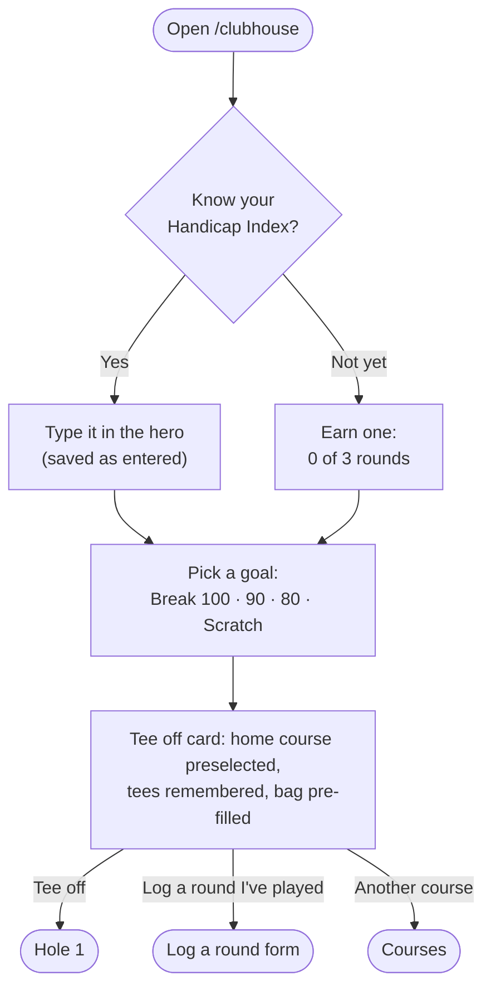
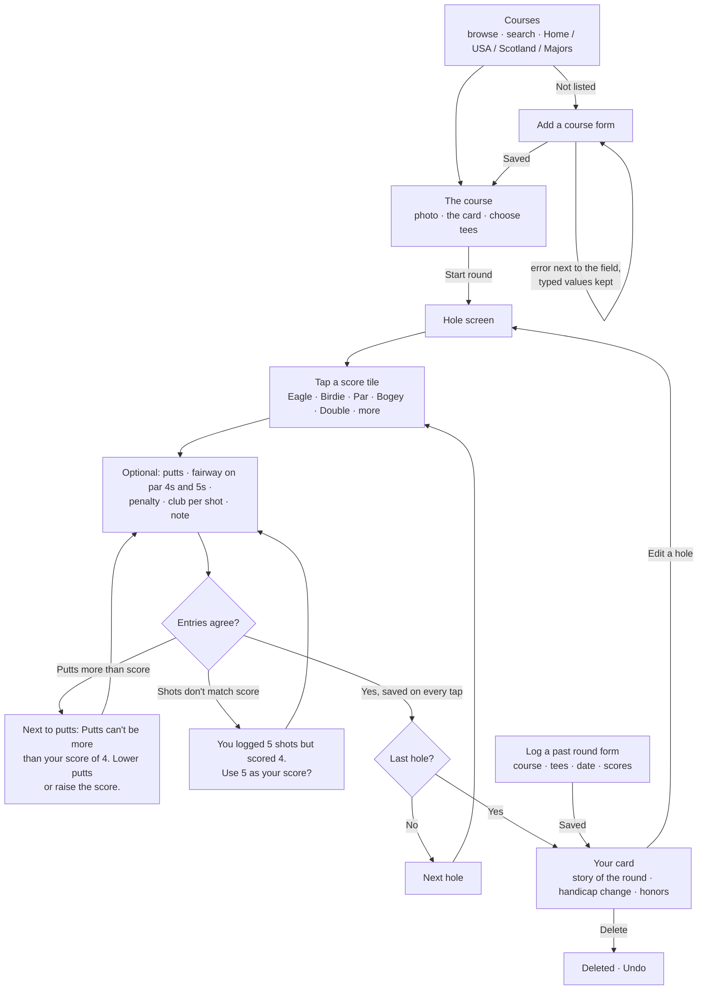
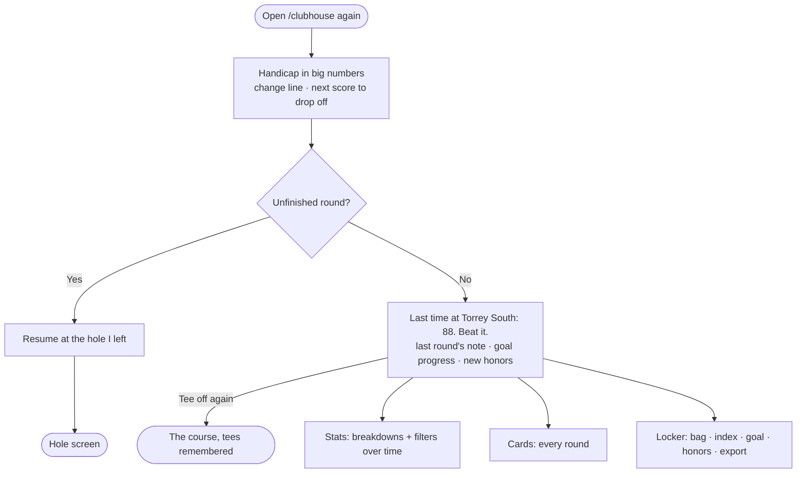

# 18 Eagles · User Flows

A personal golf round journal. Everything is saved on this device (localStorage).

**The main task, as one sentence:**
> I pick my course → I tee off → I tap my score on each hole (and the clubs, if I want) → I finish → my card is saved and my handicap moves.

## The three flows

1. **First visit:** I open 18 Eagles → the big handicap space asks one question (enter my index, or earn one with
   3 rounds) and my goal (Break 100 / 90 / 80 / scratch) → my home course is already chosen → I tap **Tee off** → I'm on hole 1.
2. **Main task:** I choose a course → I pick my tees → I score each hole (score tiles, putts, fairway, penalties,
   clubs, a note) → after the last hole I see my card, the story of the round, and what changed.
3. **Coming back:** I open 18 Eagles → I see my handicap and how it moved, and any unfinished round to resume → "Last time at
   Torrey South: 88. Beat it." → I tee off at the course I play most, with last round's note in view.

### 1 · First visit (nothing saved)

### 2 · Main task: play a round

### 3 · Coming back

## Routes (a page for each step, one shared nav)
| Route | Step | Nav label |
|---|---|---|
| `/clubhouse` | First visit / coming back home: the handicap, tee off, resume | Clubhouse |
| `/clubhouse/courses` | Choose a course | Courses |
| `/clubhouse/courses/[slug]` | The course, its card, tee choice, start | — |
| `/clubhouse/courses/new` | Form: add a course | — |
| `/clubhouse/rounds/[id]/[hole]` | Playing: the hole screen | — (its own focused header) |
| `/clubhouse/rounds/[id]` | The finished card, the story, what changed | — |
| `/clubhouse/rounds` | Every card (history) | Cards |
| `/clubhouse/rounds/new` | Form: log a round I've played | — |
| `/clubhouse/stats` | Breakdowns with filters | Stats |
| `/clubhouse/locker` | The bag, index and goal, honors, export/reset | Locker |

## States and errors we design for
- **Empty:** no rounds → the hero asks, the tee off card is ready. No blank stats: they show "after 1 round" previews with the goal.
- **One round:** the stats are honest ("1 round") and the handicap tracker reads 1 of 3.
- **In progress:** autosaved on every tap; resume from the clubhouse; the hole screen remembers the last hole.
- **9 holes:** front or back nine; 9-hole scores pair up toward the index.
- **Validation:** putts ≤ score; shot count vs score reconciled; fairway hidden on par 3s; scores 1–15; dates not in the future;
  index −10.0 to 54.0; slope 55–155; rating within reach of par. Every error sits next to its field and says what to do.
- **Destructive:** delete a round → Undo. Erase everything (Locker) → the one confirmation dialog.
